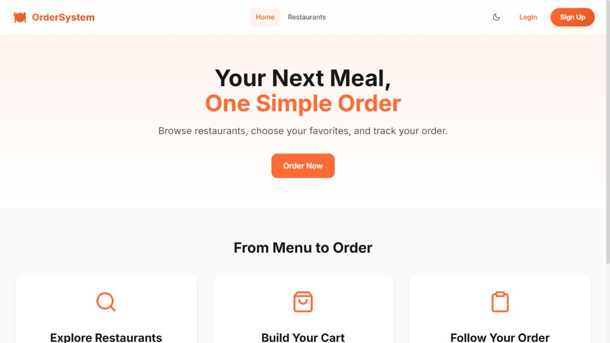

# Food Order System · Frontend

[](https://github.com/Smokiestfox/food-order-system-frontend/actions/workflows/ci.yml)

A React + TypeScript client for browsing restaurants, building a cart, and following food orders. The companion API is built with NestJS and PostgreSQL.

**[Backend API](https://github.com/Smokiestfox/food-order-system-backend) · [Architecture & ERD](https://github.com/Smokiestfox/food-order-system-backend/blob/main/docs/ARCHITECTURE.md) · [Create local demo data](https://github.com/Smokiestfox/food-order-system-backend/blob/main/docs/DEMO.md)**



## Features

- Public restaurant and menu browsing.
- Customer/restaurant-owner registration and JWT login.
- Cart quantities, delivery details, order submission, and order history.
- Restaurant-owner order dashboard and status updates.
- Light/dark theme and responsive navigation.

The home screen above can be viewed without the API. Restaurant data and account/order flows require the backend. There is no payment-gateway integration; payment methods are order data. Restaurant/menu creation for a local demo is available through the backend's Swagger walkthrough.

## Run locally

Recommended: **Node.js 24 LTS**. Start the [backend and PostgreSQL](https://github.com/Smokiestfox/food-order-system-backend#run-the-api-and-database) first, then:

```sh
git clone https://github.com/Smokiestfox/food-order-system-frontend.git
cd food-order-system-frontend
npm ci
cp .env.example .env
npm run dev
```

On PowerShell, `Copy-Item .env.example .env` works too.

Open **http://localhost:5173**. The example `VITE_API_URL=/api` sends browser requests through Vite's development proxy to `http://localhost:3000`. Restart Vite after changing environment variables.

The existing fallback is `http://localhost:3000/api` when no variable is set. For a deployed build, set `VITE_API_URL` to your reachable API base URL before building, or provide a same-origin `/api` reverse proxy. Client-side routes also need the host's SPA fallback to `index.html`.

## Check and build

```sh
npm test
npm run lint
npm run build
npm run preview
```

Tests verify the API boundary: snake_case fields used by the UI become the camelCase DTO fields expected by NestJS, and response entities/decimal strings are normalized back for display. CI runs tests, lint, and the production build.

`npm run preview` serves the built files for local inspection; it is not a deployment command.

## Structure

```text
src/
  pages/       Home, auth, restaurants, cart, orders, owner dashboard
  components/  Shared navigation
  services/    Axios, API field normalization, endpoint clients
  stores/      Auth, cart, and theme state with Zustand
  styles/      Shared Sass tokens and utilities
  types/       Frontend contracts
test/          API-contract normalization checks
docs/images/  Screenshot of the running application
```
